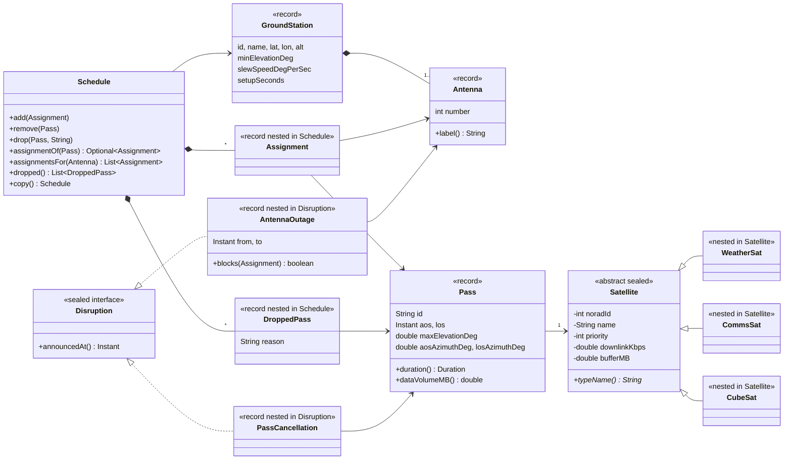
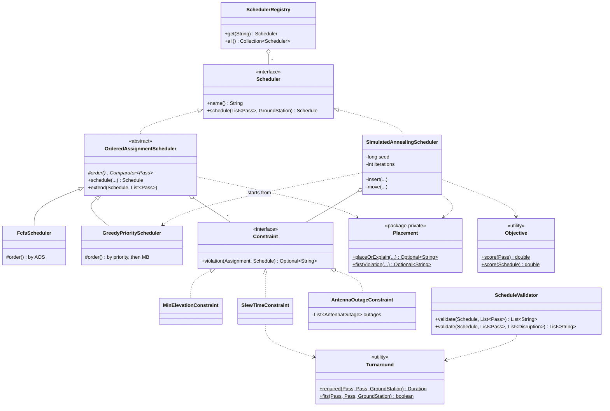
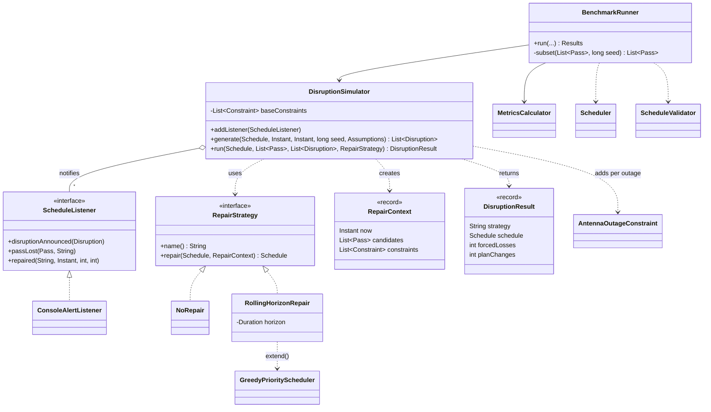

# OrbitSlot: UML class diagrams

Drawn from the code in `src/orbitslot/` (Stage 5). Split into four views so each
fits on a slide. Only the important members are shown; getters of records
are left out. Renders on GitHub and in VS Code (Mermaid).

Legend: `<|--` inheritance / implements, `*--` composition, `o--` aggregation,
`-->` association, `..>` dependency (uses).

## 1. Domain model (`model`)

## 2. Scheduling: Strategy + Template Method (`scheduler`, `constraint`)

## 3. Disruptions, repair (Strategy) and alerts (Observer) (`repair`, `alert`)

## 4. Input and output (`io`, `catalog`, `scenario`, `metrics`, `output`, `chart`)

```mermaid
classDiagram
    direction TB
    class PassSource {
        <<interface>>
        +passes(List~Satellite~, GroundStation, Instant, Instant) List~Pass~
        +description() String
    }
    class SimulatedPassSource
    class Predict4JavaPassSource
    PassSource <|.. SimulatedPassSource
    PassSource <|.. Predict4JavaPassSource
    Predict4JavaPassSource --> SatelliteCatalog
    Predict4JavaPassSource ..> OmmToTleConverter

    class SatelliteCatalog {
        +load(Path, Assumptions, SatelliteFactory)$ SatelliteCatalog
        +satellites() List~Satellite~
        +excluded() List~Excluded~
        +orbitOf(Satellite) OmmRecord
    }
    class SatelliteFactory {
        +create(String typeKey, int, String) Satellite
    }
    class PriorityAssigner {
        +priorityFor(String, int) int
    }
    SatelliteCatalog ..> SatelliteFactory
    SatelliteCatalog ..> OmmJsonReader
    SatelliteFactory --> PriorityAssigner
    SatelliteFactory ..> Satellite : creates subclasses

    class Assumptions {
        +getString/getInt/getDouble/getLong(String)
        +getInstant(String) Instant
    }
    class AssumptionsLoader
    class StationLoader
    class PriorityOverridesLoader
    class OmmJsonReader
    class OmmRecord {
        <<record>>
    }
    class OmmToTleConverter
    AssumptionsLoader ..> Assumptions : creates
    OmmJsonReader ..> OmmRecord : creates

    class MetricsCalculator {
        +calculate(String, List~Pass~, Schedule, Instant, Instant) Metrics
    }
    class Metrics {
        <<record>>
    }
    MetricsCalculator ..> Metrics : creates

    class ConsolePrinter {
        +printPasses(List~Pass~)
        +printSchedule(String, Schedule, Instant, Instant)
        +printMetrics(String, List~Metrics~)
    }
    class BenchmarkPrinter

    class ChartWriter {
        +benchmark(Results, String, BufferedImage) : writes summary.png only
        +write(String, BufferedImage)
    }
    class BarChart {
        +render(title, subtitle, unit, List~Bar~, format, slots) BufferedImage
    }
    class GroupedBarChart {
        +render(title, subtitle, unit, axis, categories, List~Series~) BufferedImage
    }
    class GanttChart {
        +render(title, subtitle, List~Panel~, Instant, Instant) BufferedImage
    }
    class Canvas {
        <<package-private utility>>
        colours, fonts, ticks()
    }
    ChartWriter ..> BarChart
    ChartWriter ..> GroupedBarChart
    ChartWriter ..> Metrics
    GanttChart ..> Schedule : reads only
    BarChart ..> Canvas
    GroupedBarChart ..> Canvas
    GanttChart ..> Canvas
```

## Design patterns at a glance

| Pattern | Where | Why |
|---|---|---|
| Strategy | `Scheduler`, `RepairStrategy`, `PassSource`, `Constraint` | Swap algorithms / data sources / rules without touching the callers |
| Template Method | `OrderedAssignmentScheduler.schedule()` with abstract `order()` | FCFS and Greedy share the placement loop, differ only in sort order |
| Observer | `DisruptionSimulator` + `ScheduleListener` | Alerts are decoupled from the simulation; tests use their own listener |
| Factory | `SatelliteFactory` | One place maps a type key to the right `Satellite` subclass |
| Registry | `SchedulerRegistry` | Command-line name to scheduler; adding an algorithm = one line |
| Sealed hierarchy + pattern matching | `Disruption` | `switch` over disruptions is checked for completeness by the compiler |
